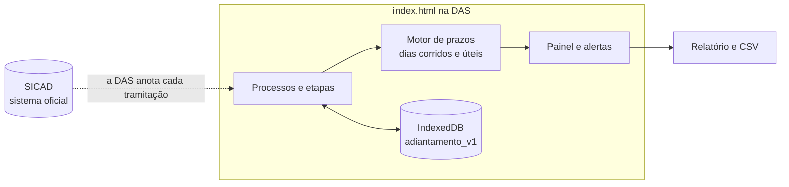

# Controle de Adiantamentos · contexto e arquitetura

> Alunos: Jaqueline e Linicker (DAS/POLITEC e SESP Gabinete)
> Fonte: `PROJETO.md` completado (29/10/2026) e a arquitetura do curso: **HTML monolítico, offline first**.
> Os itens marcados **[proposta]** estão no `PROJETO.md` e precisam de confirmação no Sprint 0.

---

## 1. O problema

O adiantamento (suprimento de fundos) tramita todo no **SICAD**, mas sem passar
de forma obrigatória pela DAS/POLITEC. Às vezes o servidor lança direto e o
processo chega à SESP sem aviso. Além disso, ninguém na POLITEC acompanha em que
etapa está cada processo nem quando vencem os prazos da prestação de contas.

| Dado | Valor informado |
|---|---|
| Volume | 5 processos na POLITEC e 55 na SESP (por ano) |
| Duração do pedido inicial | 5 dias por processo |
| Etapas | 10 no pedido + 6 na prestação de contas (resumo dos alunos) |
| Prazos (Decreto nº 1.487/2022) | aplicação em 90 dias (180 para intervenção predial); prestação em 30 dias; correção em 10 dias úteis |

**Dor**: erro na solicitação e na prestação de contas, e demora na compra ou no
serviço emergencial.

## 2. O que o MVP faz e o que não faz

| Faz | Não faz |
|---|---|
| Registra o pedido na DAS, com checklist dos 3 orçamentos e a justificativa | Substitui o SICAD |
| Acompanha as 12 etapas, com data de entrada e saída de cada uma | Autoriza, paga ou aprova |
| Calcula os prazos do decreto e alerta antes de vencer | Valida a autenticidade de nota fiscal |
| Registra devoluções da contabilidade como pendências com prazo | Integra com o SICAD |
| Registra as notas fiscais e compara com o valor concedido | Guarda CPF |
| Painel: processos por situação, tempo por etapa, devoluções | |

**Critério de aceite**: com 10 pedidos fictícios, a DAS registra um pedido
completo, avança as etapas, registra uma devolução e vê no painel os processos
vencidos e o tempo por etapa.

## 3. Arquitetura

Um único `index.html` que a DAS abre no navegador. Os processos ficam no
IndexedDB, com backup `.json`. Os alunos já tinham escolhido esse formato
(HTML único, GitHub Pages), então não há troca de stack.

**Prazos**: o motor calcula em dias corridos (aplicação e prestação) e em dias
úteis (correção), com os feriados nacionais e de MT numa lista embutida que a
DAS pode editar **[proposta]**.

## 4. Telas

| Rota | Tela | O que faz |
|---|---|---|
| `#/painel` | Painel | Processos por situação, vencidos, a vencer em 7 dias, tempo médio por etapa |
| `#/pedido/novo` | Novo pedido | Unidade, finalidade, tipo, valor, 3 orçamentos, justificativa (RN01) |
| `#/processo/:id` | Processo | Linha do tempo das etapas, pendências, prazos, avançar etapa |
| `#/processo/:id/prestacao` | Prestação de contas | Notas fiscais e comparação com o valor concedido (RN06) |
| `#/relatorio` | Relatório | Tempo por etapa, devoluções e motivos, CSV |
| `#/config` | Configuração | Feriados, backup, dados fictícios |

## 5. Modelo de dados (IndexedDB `adiantamento_v1`)

| Store | Campos |
|---|---|
| `processos` | id, numero_sicad, unidade, solicitante, finalidade, tipo (compra, serviço, predial), valor_solicitado, valor_concedido, situacao, etapa_atual, pago_em, fim_aplicacao, criado_em |
| `orcamentos` | id, processo_id, fornecedor, cnpj, valor |
| `etapas` | id, processo_id, etapa, entrada_em, saida_em, responsavel |
| `pendencias` | id, processo_id, motivo, aberta_em, prazo, resolvida_em |
| `notas` | id, processo_id, numero, cnpj, valor, data |
| `feriados` | data, nome |
| `log` | data_hora, acao, processo_id, detalhe |

## 6. Regras

As regras RN01 a RN07 estão no `PROJETO.md`. As que viram cálculo:

| Regra | Cálculo |
|---|---|
| RN03 | `fim_aplicacao = pago_em + 90 dias` (180 se tipo = predial) |
| RN04 | `prazo_prestacao = fim_aplicacao + 30 dias corridos` |
| RN05 | `prazo_correcao = aberta_em + 10 dias úteis` |
| Alerta | vencido (vermelho), vence em até 7 dias (âmbar) |

## 7. LGPD e segurança

Nome e matrícula do solicitante, valores e dados de fornecedor (pessoa
jurídica). Sem CPF. Os dados ficam no computador da DAS, e o GitHub Pages
publica só o app. A faixa do topo diz que o app é um protótipo, sem validade
administrativa (risco levantado pelos alunos).

## 8. KPIs

Tempo do pedido ao pagamento (linha de base: 5 dias), percentual de prestações
devolvidas, pedidos que chegaram à SESP sem a DAS e processos com prazo vencido.
