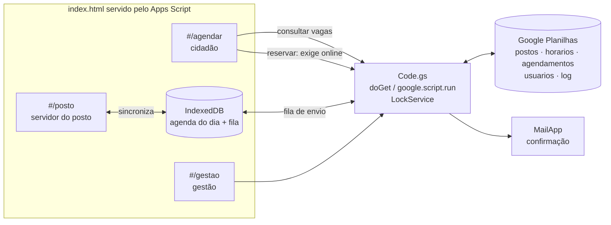

# Agendamento CIN · contexto e arquitetura

> Aluno: Elthon (Identificação Civil)
> Fonte: `PROJETO.md` (versão de 29/10/2026 09:08) e a decisão de arquitetura do
> professor: **HTML monolítico, offline first**.
> Os itens completados pelo professor estão listados no `README.md`.

---

## 1. O problema

Cada posto de identificação usa o Google Agenda do seu jeito. Hoje o cidadão
liga para a unidade, recebe um link do Google Agenda e marca o horário. Por
isso, a equipe não tem uma visão das reservas, das faltas e dos cancelamentos,
e o processo de marcar leva vários minutos por pessoa.

| Dado do AS-IS | Valor informado |
|---|---|
| Volume | 100 agendamentos por dia |
| Frequência | diária |
| Entradas | nome, telefone, e-mail (se houver) |
| Decisão | disponibilidade de data e horário |
| Exceção | data ocupada: o cidadão escolhe outra |
| Contexto | 429.378 CIN emitidas em MT em 2025 (Politec-MT, citado pelo aluno) |

**Dor**: agenda fragmentada por posto, sem taxa de comparecimento nem de
cancelamento. Além disso, a análise documental e a emissão continuam humanas e
ficam fora do escopo.

## 2. O que o MVP faz e o que não faz

| Faz | Não faz |
|---|---|
| Cadastro de postos, horários e vagas | Integração com o SIC ou outro sistema oficial |
| Calendário público com só as vagas abertas | Validação de documentos e emissão da CIN |
| Formulário com nome, telefone, e-mail e CPF opcionais | SMS ou WhatsApp |
| Protocolo e confirmação por e-mail | Implantação nos 10 postos ao mesmo tempo |
| Painel do posto: reservas, cancelamento, comparecimento | Aplicativo de celular próprio |
| Painel da gestão com indicadores básicos | Relatórios gerenciais complexos |

**Critério de aceite** (do aluno, completado): o cidadão conclui um
agendamento e recebe o protocolo; o posto vê a reserva, cancela e registra o
comparecimento; e duas pessoas tentando a última vaga ao mesmo tempo não geram
reserva duplicada.

## 3. Decisão de arquitetura: HTML monolítico, offline first

O aluno escolheu Google Apps Script com Google Planilhas. A arquitetura do
curso pede HTML monolítico e offline first, e aqui as duas se encontram:

- **Monolítico**: a interface é **um único `index.html`** (CSS e JS embutidos),
  servido pelo próprio Apps Script (`HtmlService`). As três áreas (cidadão,
  posto e gestão) ficam no mesmo arquivo, separadas por rota.
- **A reserva exige servidor.** Uma agenda pública, usada por muitas pessoas ao
  mesmo tempo, precisa de uma fonte única de vagas. Sem ela, duas pessoas
  pegariam a mesma vaga (RN04). Por isso, a confirmação da reserva é a única
  operação que exige internet, e ela passa por um `LockService` no Apps Script.
- **Offline first onde dá**: o painel do posto guarda a agenda do dia no
  IndexedDB. O servidor do posto consulta as reservas e registra o
  comparecimento mesmo com a internet instável. Os registros ficam numa fila e
  são enviados quando a conexão volta.



| Pedido do aluno | Como a arquitetura atende |
|---|---|
| Google Apps Script + Planilhas | O Apps Script serve o `index.html` e grava nas Planilhas |
| Link público para o cidadão | URL do app da web publicado pelo Apps Script |
| Área restrita do posto e da gestão | Conta Google institucional do servidor (`Session.getActiveUser()`) comparada à aba `usuarios` |
| Sem custo | Cotas gratuitas do Google para contas institucionais |
| Controle de vagas | `LockService` na reserva e conferência de capacidade antes de gravar |

### 3.1 Princípios

1. **Um arquivo de interface** (`index.html`) e **um arquivo de servidor**
   (`Code.gs`). Sem framework e sem biblioteca externa.
2. **Reserva sempre on-line e com trava.** Consulta, painel do posto e
   comparecimento funcionam com a rede instável.
3. **Dado mínimo do cidadão**: nome e telefone ou e-mail. CPF opcional, guardado
   só com os 4 últimos dígitos, para conferir a consulta da reserva.
4. **O posto só vê o próprio posto** (RN05), conferido no servidor, e não só na tela.

### 3.2 Estrutura de pastas

```
Apps/agendamento-cin/
├── index.html          ← a interface (cidadão, posto, gestão)
├── Code.gs             ← funções do Apps Script (vagas, reserva, painel)
├── appsscript.json     ← manifesto (fuso America/Cuiaba, escopos)
├── contexto.md
├── sprint.md
├── PROJETO.md
├── projeto.json
├── envio-original.json
├── planilha-modelo/    ← abas da planilha em CSV (postos, horarios, agendamentos, usuarios, log)
└── testes/             ← roteiro de testes e dados fictícios
```

O código é mantido no repositório e enviado ao Apps Script com o `clasp`
(ferramenta de linha de comando do Google), ou colado no editor.

## 4. Telas (rotas)

| Rota | Quem | O que faz |
|---|---|---|
| `#/agendar` | Cidadão | Escolhe o posto (só os ativos), a data e o horário com vaga |
| `#/agendar/dados` | Cidadão | Nome, telefone ou e-mail, CPF opcional, aceite do aviso de privacidade |
| `#/comprovante/:protocolo` | Cidadão | Protocolo, posto, data, horário, documentos a levar, botão de cancelar |
| `#/consultar` | Cidadão | Consulta ou cancela pelo protocolo + 4 últimos dígitos do CPF ou o telefone |
| `#/posto` | Servidor do posto | Agenda do dia e da semana, comparecimento, cancelamento, bloqueio de horário |
| `#/posto/horarios` | Servidor do posto | Cria a grade de horários e vagas, feriados e bloqueios |
| `#/gestao` | Gestão | Indicadores por posto, cadastro de postos e de usuários |

## 5. Modelo de dados (abas da planilha)

| Aba | Chave | Colunas |
|---|---|---|
| `postos` | `posto_id` | nome, municipio, endereco, email, ativo, documentos_orientacao |
| `horarios` | `horario_id` | posto_id, data, hora, capacidade, ocupadas, situacao (aberto, bloqueado) |
| `agendamentos` | `protocolo` | posto_id, horario_id, nome, telefone, email, cpf_final4, status, criado_em, cancelado_em, compareceu_em |
| `usuarios` | `usuario_id` | email, perfil (posto, gestão), posto_id, ativo |
| `log` | `id` | data_hora, usuario, acao, protocolo, detalhe |

**Status do agendamento**: `confirmado` → `cancelado` ou `compareceu` ou
`ausente` (marcado pelo posto ao fim do dia).

## 6. Regras de negócio

| ID | Regra | Origem |
|---|---|---|
| RN01 | Só exibir postos ativos | aluno |
| RN02 | Só exibir horários abertos e com vaga | aluno |
| RN03 | Protocolo único por reserva | aluno |
| RN04 | Nenhuma reserva acima da capacidade (trava no servidor) | aluno |
| RN05 | O posto só gerencia a própria agenda | aluno |
| RN06 | Um agendamento ativo por telefone (ou CPF) em cada posto | completado |
| RN07 | Cancelamento pelo cidadão até 2 h antes; a vaga volta para o calendário | completado |
| RN08 | Ausência: tolerância de 15 min; depois o posto marca ausente | completado |
| RN09 | Agendamento com no mínimo 1 dia e no máximo 30 dias de antecedência | completado |
| RN10 | Dados do cidadão apagados 90 dias após a data do atendimento; ficam só as contagens | completado |

## 7. LGPD

- **Dados**: nome, telefone ou e-mail, CPF opcional (só os 4 últimos dígitos).
- **Finalidade**: organizar o atendimento da CIN. A base legal (execução de
  política pública, LGPD art. 7º, III) deve ser validada pelo encarregado.
- **Retenção**: 90 dias após o atendimento (RN10), com rotina diária do Apps Script.
- **Acesso**: o posto vê só a sua agenda; a gestão vê indicadores; toda ação
  administrativa vai para a aba `log`.
- **Aviso de privacidade** na tela de dados, antes do envio.

## 8. KPIs

| KPI | Fórmula |
|---|---|
| Ocupação das vagas | agendamentos confirmados ÷ vagas abertas × 100 (meta do aluno: 70% ou mais) |
| Comparecimento | compareceu ÷ agendamentos com data no período × 100 (meta: 85% ou mais) |
| Cancelamento | cancelados ÷ agendamentos × 100 |
| Antecedência média | média de (data do atendimento − data da reserva) |
| Tempo para agendar | tempo da abertura do link ao protocolo (amostra no piloto) |

## 9. Riscos de arquitetura

| Risco | Mitigação |
|---|---|
| Cotas do Apps Script (execuções, e-mails por dia) | Conta institucional (cota maior), e-mail só na reserva e no cancelamento, teste de carga com 100 reservas por dia |
| Duas pessoas na última vaga | `LockService` + conferência da capacidade antes de gravar |
| TI não autoriza a publicação | Piloto com dados fictícios até a autorização |
| E-mail não chega | Protocolo na tela e consulta pelo `#/consultar` |
| Internet instável no posto | Agenda do dia no IndexedDB e fila de envio |
