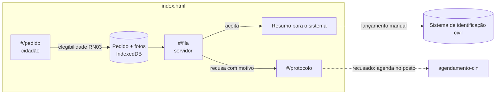

# Segunda via da CIN a distância · contexto e arquitetura

> Equipe: André, Flávia e Glauce (Identificação Civil)
> Fonte: `PROJETO.md` completado (29/10/2026) e a arquitetura do curso: **HTML monolítico, offline first**.

---

## 1. O problema

Para tirar a segunda via, o cidadão vai ao posto, faz nova coleta biométrica e
apresenta documentos, mesmo com a primeira via válida e sem mudança de dados.

| Dado | Valor informado |
|---|---|
| Volume | 21.000 solicitações por mês |
| Prazo médio de entrega | 15 dias |
| Etapas | solicitação (1 h), análise e confronto (72 h), impressão (168 h), envio ao posto (48 h), entrega |
| Meta da defesa | 5 dias úteis para a segunda via de CIN válida |

## 2. Limite do MVP: dado sensível

A equipe propôs coletar a **biometria por foto** e usar a biometria de servidores
como teste. Biometria e foto do rosto são **dados pessoais sensíveis** (LGPD,
art. 11), e a coleta remota envolve prova de vida, fraude e integração com o
sistema de identificação civil. Por isso:

- o MVP **não coleta biometria real**. A foto de teste é gerada (sem pessoa
  real) e fica no navegador;
- o MVP prova o **fluxo**: elegibilidade, pedido completo, fila do servidor,
  aceite ou recusa com motivo, resumo para lançar no sistema;
- a coleta biométrica real, a prova de vida e a integração ficam para a
  empresa contratada, com a TI e o encarregado de dados (fora do MVP).

## 3. Arquitetura

Um único `index.html` com dois perfis. No MVP, o pedido do cidadão e a fila do
servidor ficam no mesmo navegador (demonstração). Em produção, o envio precisa
de um servidor institucional, como no **agendamento-cin** (Apps Script), que já
resolve o envio de pedidos públicos para a POLITEC.

**Câmera**: o navegador do celular abre a câmera (`getUserMedia` ou
`<input capture>`). A foto é reduzida para 800 px e guardada como Blob.

**Ligação com o agendamento-cin**: o pedido não elegível ou recusado leva o
cidadão ao agendamento no posto, que já é outro app do curso.

## 4. Telas

| Rota | Perfil | O que faz |
|---|---|---|
| `#/pedido` | Cidadão | Perguntas de elegibilidade, dados, fotos de rosto e documento, envio |
| `#/protocolo/:id` | Cidadão | Situação e motivo da recusa |
| `#/fila` | Servidor | Pedidos por situação, elegibilidade, fotos |
| `#/pedido/:id/resumo` | Servidor | Dados no formato do cadastro, para copiar ou imprimir |
| `#/indicadores` | Gestão | Pedidos, elegíveis, aceitos, recusados, tempo |
| `#/config` | todos | Perfil, backup, dados fictícios, apagar pedidos decididos |

## 5. Modelo de dados (IndexedDB `cin_segunda_via_v1`)

| Store | Campos |
|---|---|
| `pedidos` | protocolo, nome, cpf, nascimento, numero_cin, validade_cin, mudou_dados, contato, criado_em, situacao, motivo |
| `fotos` | id, protocolo, tipo (rosto, documento), conteudo |
| `decisoes` | id, protocolo, resultado, motivo, servidor, data |
| `log` | data_hora, acao, protocolo, detalhe |

## 6. Regras

| Regra | Efeito |
|---|---|
| RN01 CPF válido (dígitos verificadores) | bloqueia o envio |
| RN02 fotos de rosto e documento | bloqueia o envio |
| RN03 CIN válida e sem mudança de dados | não elegível: orienta ir ao posto (agendamento-cin) |
| RN05 recusa com motivo | o cidadão vê o motivo no protocolo |
| RN06 apagar pedido e fotos após a decisão | rotina em `#/config` |

## 7. KPIs

Tempo do pedido à entrega (linha de base: 15 dias; meta: 5 dias úteis),
percentual de pedidos elegíveis e taxa de recusa por motivo.
