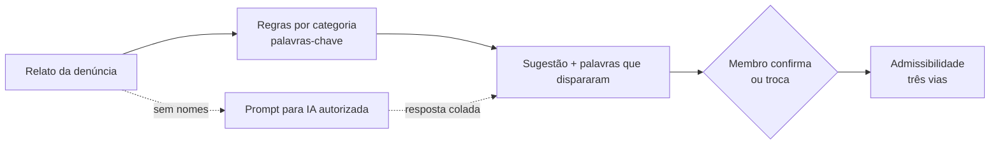

# Comissão de Ética · contexto e arquitetura

> Equipe: Letícia e Thiago (Comissão de Ética)
> Fonte: `PROJETO.md` completado (29/10/2026) e a arquitetura do curso: **HTML monolítico, offline first**.

---

## 1. O problema

A denúncia chega por e-mail. A Comissão marca uma reunião, que depende da
agenda de todos os membros, para decidir se a denúncia é acatada (três
vias: acatada, não acatada por falta de enquadramento ou encaminhada à
corregedoria). Depois vêm as oitivas, a reunião da tríade e o relatório de
recomendações. As atas ficam no Sigadoc, e o controle, numa planilha.

| Dado | Valor informado |
|---|---|
| Volume | 2 casos por mês (24 por ano) |
| Esforço | cerca de 10 h por processo |
| Reunião de classificação | 1 h por denúncia |
| Oitiva | 1 h a 4 h cada |
| Meta da defesa | triagem e preparação de 1 h para 20 min por processo |

**Gargalo** (hipótese da equipe): o tempo de reunião para a triagem e para
montar do zero os roteiros de oitiva, e não a análise em si.

## 2. O que o MVP faz e o que não faz

| Faz | Não faz |
|---|---|
| Registra a denúncia com protocolo, partes fictícias, relato e anexos | Recebe denúncia real |
| Sugere a classificação inicial, com a explicação da sugestão | Decide admissibilidade ou responsabilidade ética |
| Registra a admissibilidade (três vias) com justificativa | Envia comunicação oficial |
| Controla etapas, responsáveis e prazos | Integra com o Sigadoc |
| Sugere o roteiro de oitiva pela categoria, para revisão | Substitui a deliberação colegiada |
| Gera minutas (comunicação, ata, recomendação) | Guarda documento sigiloso em produção |
| Relatório sem nomes nem relatos | |

## 3. "IA" sem internet: classificação assistida por regras

Os relatos são sigilosos e o app funciona sem internet. Por isso, a
classificação não chama um serviço de IA externo:

1. **Regras explicáveis**: cada categoria do Código de Ética tem uma lista de
   palavras e expressões. O app pontua o relato, sugere as categorias com mais
   pontos e **mostra as palavras que dispararam cada sugestão**.
2. **Prompt pronto**: um botão monta o prompt (categorias + relato sem os nomes)
   para quem quiser usar uma ferramenta de IA **autorizada** pela instituição. A
   resposta é colada de volta como sugestão.
3. **Validação humana** (RN02): a sugestão só vale depois que um membro confirma
   ou troca a categoria, com justificativa. O caso não avança sem isso.

As categorias e as palavras ficam numa tabela editável (`#/config`), porque a
Comissão precisa conferir a lista com o Código de Ética (LC nº 112/2002).

## 4. Telas

| Rota | Perfil | O que faz |
|---|---|---|
| `#/painel` | todos | Casos por etapa, prazos, pendências |
| `#/denuncia/nova` | Secretário | Registro com protocolo, partes, relato, anexos |
| `#/caso/:id` | todos | Ficha, linha do tempo e histórico |
| `#/caso/:id/classificacao` | Presidente e membros | Sugestão, palavras, prompt, confirmação |
| `#/caso/:id/admissibilidade` | Presidente | Três vias com justificativa, prova pendente |
| `#/caso/:id/oitivas` | Membros da tríade | Roteiro sugerido, revisão, termo |
| `#/caso/:id/documentos` | Secretário | Minutas de comunicação, ata e recomendação |
| `#/caso/:id/encerramento` | Presidente | Conferência das etapas e encerramento |
| `#/relatorio` | Presidente | Contagens e prazos, sem nomes |
| `#/config` | todos | Perfil, categorias e palavras, backup, apagar caso |

## 5. Modelo de dados (IndexedDB `comissao_etica_v1`)

| Store | Campos |
|---|---|
| `denuncias` | id, protocolo, data_recebimento, canal, relato, denunciante, denunciado, etapa, situacao, prazo, sigilo |
| `anexos` | id, denuncia_id, nome, tipo, conteudo |
| `classificacoes` | id, denuncia_id, sugeridas, palavras, origem (regras, IA externa), confirmada, categoria_final, justificativa, membro, data |
| `deliberacoes` | id, denuncia_id, tipo (admissibilidade, recomendação), decisao, justificativa, membros_presentes, data |
| `oitivas` | id, denuncia_id, pessoa_ouvida, data, roteiro, termo |
| `categorias` | id, nome, artigos, palavras, roteiro_base |
| `log` | data_hora, perfil, acao, denuncia_id, justificativa |

## 6. LGPD e sigilo

Nomes, matrículas e relatos são dados pessoais em processo sigiloso. Por isso:
os dados ficam só no computador da Comissão (sem servidor, sem GitHub com
dados), o prompt sai sem os nomes, o relatório não mostra nomes nem relatos, e
um botão apaga o caso encerrado. Toda ação registra perfil, data e
justificativa (RN05).

## 7. KPIs

Tempo de triagem e classificação (1 h → 20 min) e tempo de preparação da
oitiva (2 h → 20 min), medidos no piloto de 30 dias com casos fictícios.
