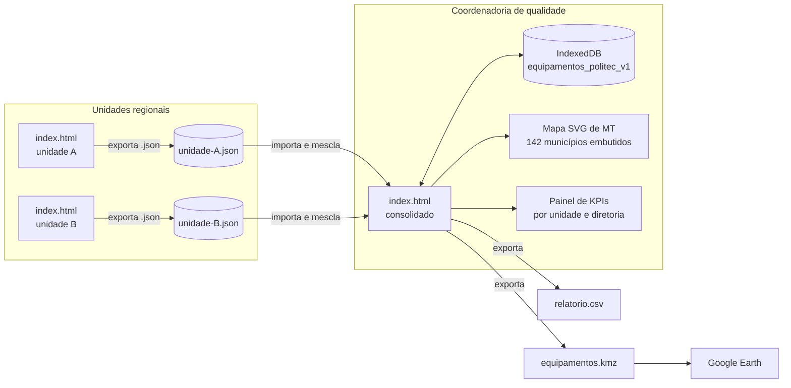

# Mapa de Equipamentos POLITEC · contexto e arquitetura

> Aluno: João Lucas Nogueira Ponce (Coordenadoria de qualidade)
> Fonte: `PROJETO.md` (versão de 28/10/2026 08:44) e a decisão de arquitetura do
> professor: **HTML monolítico, offline first**.
>
> **Atenção**: o formulário veio com a maior parte das seções em branco ou
> preenchida com "1" (MVP, papéis, entidades, regras, telas, KPIs). Este
> documento **propõe** o escopo a partir do resumo e do problema. Os itens
> marcados com **[proposta]** já estão no `PROJETO.md` completado e precisam da confirmação do João e da coordenadora
> no Sprint 0.

---

## 1. O problema

A POLITEC tem equipamentos espalhados pelo estado, e **nem todos têm contrato
de manutenção**. Hoje não existe acompanhamento em ferramenta. Por isso, quando
um equipamento para, ninguém sabe de antemão:

- quais equipamentos estão sem cobertura de contrato;
- quais, ao parar, **param o setor inteiro** (não há outro igual na unidade);
- quanto custa cada dia de parada, por unidade e por diretoria;
- onde cada equipamento está e qual o histórico de manutenção dele.

O formulário informa a entrada do processo ("documentos comprovantes de
manutenções"), volume de **200** por mês e frequência mensal. Além disso, a
saída citada é "laudo e a carteira de identidade", o que indica que a parada
afeta tanto a perícia quanto a emissão de documentos. **[proposta]**

## 2. Proposta de MVP

**Objetivo**: em um mapa de Mato Grosso, mostrar cada equipamento da POLITEC
com a situação de contrato, o histórico de manutenção e o **custo estimado de
parada**, somado por unidade e por diretoria, para apoiar a decisão de
contratar manutenção.

| Faz | Não faz |
|---|---|
| Cadastra unidades, equipamentos, fotos, contratos, manutenções e paradas | Abre chamado com o fornecedor |
| Calcula impacto e custo de parada por equipamento, unidade e diretoria | Controla estoque, peças ou patrimônio contábil |
| Mostra os equipamentos no mapa de MT, offline | Depende de internet para o mapa |
| Exporta `.kmz` para abrir no **Google Earth** (web ou Pro) | Integra com sistema de patrimônio ou SEI |
| Painel com KPIs: sem contrato, ponto único de falha, custo de parada | Controla acesso por login (ver seção 9) |
| Consolida os arquivos enviados pelas unidades | Envia dados a servidor |

**Primeira tela**: o mapa de MT com os pinos coloridos pelo risco e, ao lado, os
4 KPIs principais.

**Critério de aceite**: a coordenadoria cadastra (ou importa) os equipamentos
de 3 unidades, registra uma parada, vê o custo dela no painel, filtra os
equipamentos sem contrato no mapa e abre o `.kmz` no Google Earth com as fotos.

## 3. Decisão de arquitetura: HTML monolítico, offline first

O aluno indicou Python/Flask rodando na máquina dele e Google Earth para a
visualização. A arquitetura adotada no curso troca o servidor por **um único
arquivo `index.html`**:

| Pedido do aluno | Como o HTML monolítico atende |
|---|---|
| Rodar na máquina local | Abre por duplo clique no Edge ou no Chrome, sem Python |
| "Hospedagem: tem que ser" | O mesmo arquivo pode ir para o GitHub Pages, sem mudar nada |
| Visualização no Google Earth | Mapa offline embutido + exportação `.kmz`, que o Google Earth abre |
| Fotos dos equipamentos | Guardadas no IndexedDB, comprimidas no próprio navegador |

### 3.1 Princípios

1. **Um arquivo só.** HTML, CSS, JS, a malha dos municípios de MT e as
   bibliotecas ficam dentro do `index.html`.
2. **Offline first.** O IndexedDB é a base principal. A internet só é usada,
   de forma opcional, para abrir o Google Earth com o `.kmz` exportado.
3. **Cada unidade tem a própria cópia.** A sincronização é feita por arquivo:
   a unidade exporta o `.json`, e a coordenadoria importa e mescla.
4. **Nenhum dado pessoal.** Responsável é registrado por cargo ou matrícula,
   nunca por CPF.
5. **Navegador alvo: Edge e Chrome.**

### 3.2 Visão geral



### 3.3 Camadas dentro do `index.html`

| Camada | Responsabilidade | Tecnologia |
|---|---|---|
| Roteador | Telas por hash | JS puro |
| Estado | Coleções e filtros ativos | objeto `estado` + IndexedDB |
| Fotos | Reduzir para 1280 px, JPEG 0,75, miniatura de 240 px | `<canvas>` + Blob no IndexedDB |
| Cálculo | Impacto, custo de parada, risco, MTTR, disponibilidade | JS puro (funções testáveis) |
| Mapa | Contorno de MT, municípios e pinos | SVG gerado a partir de GeoJSON embutido |
| Exportação | `.kmz`, `.json`, `.csv`, relatório impresso | JSZip + `@media print` |
| Sincronização | Mesclar arquivos das unidades | `id` + `atualizadoEm` |

### 3.4 Estrutura de pastas do projeto

```
Apps/equipamentos-google-earth/
├── index.html              ← o app (único arquivo entregue)
├── contexto.md             ← este arquivo
├── sprint.md               ← plano de construção
├── PROJETO.md              ← especificação enviada pelo aluno
├── projeto.json            ← resposta do formulário (importável)
├── vendor/                 ← JSZip minificado + VERSOES.md
├── dados-base/
│   ├── mt-municipios.geojson   ← malha IBGE simplificada (fonte do mapa)
│   └── mt-municipios.csv       ← código IBGE, nome, latitude, longitude da sede
├── exemplos/
│   └── seed-ficticio.json  ← unidades e equipamentos fictícios para teste
└── testes/
    └── testes.html         ← testes das funções de cálculo
```

## 4. Telas (rotas)

| Rota | Tela | Quem usa | O que faz |
|---|---|---|---|
| `#/mapa` | Mapa de MT | todos | Pinos por risco, filtros (sem contrato, parado, diretoria, tipo), clique abre a ficha |
| `#/painel` | Painel | coordenadoria, diretoria | KPIs, ranking de unidades por custo de parada, lista de pontos únicos de falha |
| `#/equipamentos` | Lista | coordenadoria, unidade | Busca, filtros, ordenação, exportação CSV |
| `#/equipamento/:id` | Ficha | todos | Dados, fotos, contrato, histórico de manutenção e paradas, impacto calculado |
| `#/unidades` | Unidades | coordenadoria | Cadastro das unidades, município, coordenadas, diretoria, custo de referência |
| `#/contratos` | Contratos | coordenadoria | Fornecedor, vigência, valor, equipamentos cobertos, alerta de vencimento |
| `#/paradas` | Paradas e manutenções | unidade | Abrir e fechar parada, registrar manutenção e comprovante |
| `#/importar` | Importar e consolidar | coordenadoria | CSV da planilha atual, `.json` das unidades, relatório de conflitos |
| `#/exportar` | Exportar | todos | `.kmz` para o Google Earth, `.json` de backup, CSV, relatório impresso |
| `#/config` | Configuração | coordenadoria | Perfil da cópia (unidade ou coordenadoria), parâmetros de custo, limpar dados |

## 5. Modelo de dados (IndexedDB `equipamentos_politec_v1`) **[proposta]**

| Store | Chave | Campos principais |
|---|---|---|
| `diretorias` | `id` | nome, sigla |
| `unidades` | `id` | nome, tipo (sede, regional, núcleo, posto), diretoria_id, municipio_ibge, latitude, longitude, horas_uteis_dia, atendimentos_dia |
| `equipamentos` | `id` | patrimonio, nome, tipo, fabricante, modelo, numero_serie, unidade_id, setor, criticidade (1 a 5), tem_redundancia, data_aquisicao, valor_aquisicao, status (operando, parado, em manutenção, baixado), latitude, longitude, contrato_id, foto_ids |
| `contratos` | `id` | numero, fornecedor, objeto, inicio, fim, valor_mensal, sla_horas, equipamento_ids |
| `manutencoes` | `id` | equipamento_id, tipo (preventiva, corretiva), abertura, conclusao, custo_rs, fornecedor, descricao, comprovante_id |
| `paradas` | `id` | equipamento_id, inicio, fim, motivo, atendimentos_perdidos_dia, custo_alternativo_dia |
| `arquivos` | `id` | tipo (foto, miniatura, comprovante), mime, blob, tamanho |
| `parametros` | `chave` | valor_referencia_atendimento, custo_hora_parada_padrao, ... |

Todos os registros têm `id` (UUID), `criadoEm`, `atualizadoEm`, `origem`
(unidade que criou) e `excluido` (exclusão lógica, para a mescla funcionar).

## 6. Regras de cálculo (proposta) **[proposta]**

| ID | Regra |
|---|---|
| RN01 | **Ponto único de falha**: equipamento com `criticidade >= 4` e `tem_redundancia = não`. A parada dele para o setor. |
| RN02 | **Custo diário de parada** = `atendimentos_perdidos_dia × valor_referencia_atendimento + custo_alternativo_dia`. Quando a parada não traz os números, usa os da unidade e os parâmetros. |
| RN03 | **Custo de uma parada** = custo diário × dias parados (`fim − inicio`, em dias úteis). Parada aberta conta até hoje. |
| RN04 | **Risco** do equipamento = criticidade × (2 se sem contrato vigente, 1 se com contrato) × (2 se ponto único de falha, 1 se não). Faixas: baixo, médio, alto. |
| RN05 | **Contrato vigente**: `inicio <= hoje <= fim`. Faltando 60 dias para o fim, o app alerta. |
| RN06 | **MTTR** (tempo médio de reparo) = média de `conclusao − abertura` das manutenções corretivas. |
| RN07 | **Disponibilidade** = 1 − horas paradas ÷ horas úteis do período. |
| RN08 | Coordenadas do equipamento herdam as da unidade, e o usuário pode ajustar. Coordenada fora do contorno de MT é recusada. |
| RN09 | Não se registra CPF nem nome de pessoa: responsável é cargo ou matrícula. |
| RN10 | Na mescla, vence o registro com `atualizadoEm` mais recente. Conflito no mesmo minuto vai para revisão manual. |

O `valor_referencia_atendimento` (quanto vale, para a decisão, um atendimento
ou exame não realizado) **é definido pela coordenadoria**. O app não inventa
esse número, e o painel mostra o parâmetro usado ao lado de cada custo.

## 7. Mapa offline e Google Earth

**Mapa dentro do app (offline)**

- A malha municipal do IBGE para MT é simplificada (mapshaper, cerca de 2% dos
  vértices) e embutida como GeoJSON, com cerca de 300 KB.
- Projeção equirretangular ajustada à latitude média de MT, desenhada em SVG.
  Isso basta para o estado e não exige biblioteca de mapas nem *tiles* online.
- Pinos agrupados por unidade (um círculo com o número de equipamentos), na cor
  do maior risco. O zoom e o arrasto usam `viewBox`.

**Google Earth**

- O botão "Exportar para o Google Earth" gera `equipamentos.kmz` (KML + fotos
  em miniatura, compactados com JSZip).
- Pastas no KML: uma por diretoria, e dentro dela uma por unidade. Cada
  equipamento vira um *Placemark* com estilo pela faixa de risco e um balão
  com a foto, o contrato e o custo de parada.
- O `.kmz` abre no **Google Earth Pro** (desktop) ou no **Google Earth Web**
  (Projetos → Abrir → Importar arquivo KML). Essa é a única etapa que usa internet.

## 8. KPIs do painel

| KPI | Fórmula |
|---|---|
| Equipamentos sem contrato | nº com `contrato vigente = não` ÷ total × 100 |
| Pontos únicos de falha | nº que atende RN01 |
| Custo estimado de parada (período) | soma de RN03 nas paradas do período, por unidade e diretoria |
| Exposição diária | soma do custo diário (RN02) dos pontos únicos de falha **sem contrato** |
| MTTR | RN06, por tipo de equipamento |
| Disponibilidade | RN07, por unidade |
| Gasto com manutenção | soma de `custo_rs` no período |

A **exposição diária** é o número da defesa: quanto a POLITEC perderia por dia
se os equipamentos críticos sem contrato parassem.

## 9. Papéis, sincronização e LGPD

O app não tem login, porque não há servidor. Os papéis viram **perfis da cópia**:

| Perfil | Quem | Vê | Faz |
|---|---|---|---|
| Unidade | chefe ou responsável técnico da unidade | os equipamentos da própria unidade | cadastra, registra paradas e manutenções, exporta `.json` |
| Coordenadoria | Coordenadoria de qualidade | tudo | importa e mescla, define parâmetros, exporta `.kmz` e relatório |
| Diretoria | diretor | o painel consolidado (arquivo `.json` ou relatório impresso) | consulta |

- O perfil restringe telas, mas não é controle de segurança. Quem tem o arquivo
  vê os dados. Por isso, a base não guarda dado pessoal (RN09).
- **O formulário trouxe um número de 11 dígitos no campo "dados pessoais"**,
  que parece ser um CPF. Ele não entra no app e deve ser retirado do envio.
- Requisito marcado pelo aluno: **acessibilidade**. Contraste AA nos dois
  temas, navegação por teclado, rótulos em todos os campos, e o mapa sempre
  acompanhado da lista em tabela (quem não vê o mapa lê a tabela).

## 10. Riscos de arquitetura

| Risco | Mitigação |
|---|---|
| Fotos enchem o IndexedDB | Compressão para cerca de 200 KB por foto e indicador de espaço usado (`navigator.storage.estimate()`) |
| Limpeza do navegador apaga a base | `navigator.storage.persist()` e lembrete de backup semanal |
| Mescla de várias unidades gera duplicados | UUID, `atualizadoEm`, exclusão lógica e tela de conflitos |
| `.json` com fotos fica grande para enviar | Exportar com ou sem fotos. As fotos podem ir num `.zip` à parte |
| Lista real de unidades e coordenadas ainda não existe | Sprint 0 levanta com a coordenadora. O seed usa nomes fictícios em municípios reais |
| Custo de parada contestado | Parâmetros visíveis e editáveis, e fórmula mostrada ao lado de cada número |
