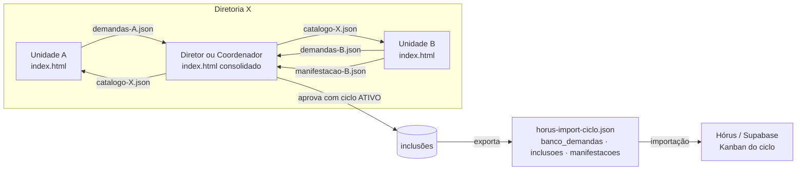

# Hórus · Banco de Demandas · contexto e arquitetura

> Aluno: Iohan Camões de Albuquerque (Planejamento de Contratações, PCA)
> Fonte: `PROJETO.md` (versão de 29/10/2026 08:47) e a decisão de arquitetura do
> professor: **HTML monolítico, offline first**.
>
> **Ponto de partida diferente dos outros apps**: o aluno já construiu este
> módulo dentro do Hórus (React + Supabase + Vercel), e os 5 marcos estão
> "Feito". Este documento descreve a **versão HTML monolítica**, que roda sem
> servidor e conversa com o Hórus por arquivo, nas mesmas tabelas. A decisão de
> seguir com ela é do aluno e do professor (Sprint 0).

---

## 1. O problema

As demandas de contratação ficam em planilhas de cada unidade. A cada ciclo do
PCA, elas são reenviadas e redigitadas, e especificação, valor e orçamento
chegam em formatos diferentes, muitas vezes sem anexo. Além disso, a diretoria
consolida tudo à mão.

| Etapa do AS-IS | Quem | Tempo (h) |
|---|---|---|
| Levantar necessidade em planilha | Servidor da unidade | 4 |
| Cotar preço (mínimo 1 orçamento) | Servidor | 8 |
| Enviar à chefia por e-mail | Servidor | 1 |
| Consolidar por grupo (custeio, investimento) | Coordenador/Diretor | 6 |
| Aprovar para o ciclo | Diretor/Coordenador | 2 |

**Dor**: recadastro a cada ciclo, o mesmo item com preço e especificação
diferentes entre unidades, histórico perdido e consolidação manual do valor
global por grupo e por unidade. Lei 14.133/2021: o PCA é obrigatório.

## 2. O que o MVP faz e o que não faz

| Faz | Não faz |
|---|---|
| Cadastra, edita e exclui demanda, com validações R1 a R6 | Substitui o Kanban do ciclo (só envia a demanda para ele) |
| Anexa o PDF do orçamento (até 10 MB) | Cotação automática de preços |
| Mostra a grade de cards do repositório da diretoria | Workflow de aprovação em várias etapas |
| Outra unidade manifesta interesse (quantidade + justificativa) | Dashboard dedicado |
| Chefia aprova para o ciclo ativo (R7) | Mede tempo de atendimento |
| Reabre item, relatório Geral e Aprovadas | Integra com sistemas externos de compras |
| Exporta as aprovações no formato das tabelas do Hórus | |

**Critério de aceite** (do aluno): com um ciclo ATIVO, ao aprovar uma demanda
do banco, ela aparece como APROVADO no ciclo e no relatório "Aprovadas", e o
item fica marcado "Aprovada no ciclo". Na versão offline, "aparecer no Kanban"
significa: o arquivo exportado é importado no Hórus e a demanda surge no
quadro do ciclo.

## 3. Decisão de arquitetura: HTML monolítico, offline first

| No Hórus (hoje) | Na versão HTML monolítica |
|---|---|
| Supabase Postgres | IndexedDB (`banco_demandas_v1`), com as mesmas colunas |
| Supabase Auth + RBAC | Perfil da cópia (ADM, Diretor, Coordenador, Gerente, Usuário setorial, Inventariante). Restringe telas, mas não é segurança |
| RLS por órgão e diretoria | Cada diretoria tem a sua base. Só circula entre diretorias o que for exportado |
| Storage + URL assinada | PDF como Blob no IndexedDB |
| Preview Open Graph de links | Fora do modo offline (o navegador não lê outro site por CORS). O usuário informa o título do link |
| jsPDF | Relatório em `@media print` (Salvar como PDF) ou jsPDF embutido **[proposta]** |
| Vercel | Arquivo aberto por duplo clique ou na pasta de rede da diretoria |
| Aprovação grava no ciclo | Aprovação grava a inclusão local e exporta `ciclo-<ano>.json/.csv` para o Hórus |

### 3.1 Fluxo entre as cópias



1. A unidade cadastra as demandas na cópia dela e exporta `demandas-<unidade>.json`.
2. O diretor ou coordenador importa e consolida. O repositório vira o
   `catalogo-<diretoria>.json`, que volta às unidades.
3. Outra unidade vê o catálogo, manifesta interesse e exporta a manifestação.
4. A chefia aprova para o ciclo ATIVO e exporta o arquivo no formato do Hórus.

### 3.2 Princípios

1. **Um arquivo só** (`index.html`), com CSS, JS e bibliotecas embutidos.
2. **Offline first**: o IndexedDB é a base. A troca é por arquivo `.json`.
3. **Mesmo modelo do Hórus**: nomes de tabela e coluna iguais aos do Supabase,
   para importar sem tradução.
4. **A aprovação é humana** (R7): o app só registra e exporta.
5. **Cada registro tem `id` (UUID), `created_at`, `updated_at`, `criado_por`**,
   para a mescla e a auditoria.

### 3.3 Estrutura de pastas

```
Apps/horus-banco-demandas/
├── index.html
├── contexto.md
├── sprint.md
├── PROJETO.md
├── projeto.json
├── vendor/                 ← jsPDF (se escolhido) + VERSOES.md
├── exemplos/
│   ├── seed-ficticio.json  ← 1 órgão, 1 diretoria, 4 unidades, 1 ciclo ATIVO, 15 demandas
│   └── unidades-medida.json
├── horus/
│   └── importar_no_horus.sql  ← (opcional) carga do arquivo exportado no Supabase
└── testes/testes.html
```

## 4. Telas (rotas)

| Rota | Quem | O que faz |
|---|---|---|
| `#/banco` | todos | Grade de cards "Banco de Demandas · repositório (N)", filtros por grupo, unidade, situação |
| `#/demanda/nova` e `#/demanda/:id` | Servidor, Gerente | Formulário com R1 a R6, anexo do PDF, links |
| `#/demanda/:id/ver` | todos | Ficha: especificação, valores, anexo, manifestações, ciclos em que entrou |
| `#/demanda/:id/interesse` | outra unidade | Quantidade + justificativa (R9) |
| `#/ciclos` | ADM, Diretor | Cadastrar o ciclo e marcar o ciclo ATIVO |
| `#/aprovar` | Diretor, Coordenador | Selecionar demandas e aprovar para o ciclo ativo (R7) |
| `#/relatorios` | Coordenador, Diretor, ADM | Relatório Geral e Aprovadas com KPIs |
| `#/trocar` | todos | Exportar e importar demandas, catálogo, manifestações e o arquivo para o Hórus |
| `#/config` | ADM | Perfil da cópia, unidade, diretoria, unidades de medida, backup |

## 5. Modelo de dados (IndexedDB, mesmas colunas do Hórus)

| Store | Colunas |
|---|---|
| `banco_demandas` | id, grupo (CUSTEIO, INVESTIMENTO), unidade_id, especificacao_tecnica (≥ 50), valor_unitario (> 0), quantidade (> 0), unidade_medida_id, valor_global (calculado), links_referencia[], justificativa (≥ 100), arquivo_pdf (Blob), preview_title, criado_por, diretoria_id, orgao_id, created_at, updated_at |
| `banco_demanda_manifestacoes` | id, banco_demanda_id, unidade_id, quantidade (> 0), justificativa (≥ 50), criado_por, orgao_id, diretoria_id, created_at; único (banco_demanda_id, unidade_id) |
| `banco_demanda_inclusoes` | id, banco_demanda_id, quadro_id, demanda_id, criado_por, orgao_id, created_at; único (banco_demanda_id, quadro_id) |
| `ciclos` | id (= quadro_id), ano, status (ATIVO, ENCERRADO) |
| `unidades`, `unidades_medida` | cadastro de apoio |
| `log` | data_hora, perfil, acao, registro |

`valor_global = valor_unitario × quantidade` (R4) é calculado no app e
conferido de novo na importação.

## 6. Regras (as 9 do aluno)

| ID | Regra | Onde fica na versão offline |
|---|---|---|
| R1 | Especificação técnica ≥ 50 caracteres | formulário + validação na importação |
| R2 | Justificativa ≥ 100 caracteres | formulário + validação na importação |
| R3 | valor_unitario > 0 e quantidade > 0 | formulário + importação |
| R4 | valor_global = valor_unitario × quantidade | cálculo no app |
| R5 | Pelo menos 1 link iniciando com http | formulário |
| R6 | PDF ≤ 10 MB, anexo opcional | formulário |
| R7 | Aprovar exige ciclo ATIVO | tela `#/aprovar` |
| R8 | Editar card: só o criador, ou ADM/Diretor | perfil + `criado_por` (não é segurança) |
| R9 | Manifestação só de outra unidade, 1 por unidade | chave única + perfil |

## 7. LGPD e segurança

- Só a identificação do autor (`criado_por`) e do aprovador. Nenhum dado
  pessoal sensível. Dados sintéticos no exercício.
- **O isolamento por diretoria muda de natureza**: no Hórus, a RLS impede a
  leitura. Na versão offline, cada diretoria tem a sua base, e o isolamento
  depende de não exportar para fora. Isso precisa constar na defesa.
- Retenção: o ciclo anual. Ciclos encerrados podem ser exportados e apagados.

## 8. KPIs (os 6 do aluno)

Total de demandas, valor global total, valor por grupo (custeio x
investimento), demandas aprovadas, unidades distintas e reuso
(manifestações). Todos calculados no relatório e na tela `#/relatorios`.

## 9. Riscos

| Risco | Mitigação |
|---|---|
| Versão offline duplica o que já existe no Hórus | Sprint 0 decide. Proposta: a versão offline serve às unidades sem acesso ao Hórus e entrega no formato dele |
| Vazamento entre diretorias por arquivo trocado | Arquivo exportado leva a diretoria e o app recusa importar catálogo de outra |
| Conflito na mescla (mesma demanda editada em duas cópias) | `updated_at` mais recente vence, e o conflito vai para revisão |
| PDFs pesam no IndexedDB e no `.json` | Exportar com ou sem anexos. Indicador de espaço usado |
| Formato do Hórus muda | O arquivo exportado leva a versão do esquema, e o Sprint 7 testa a importação no Hórus |
