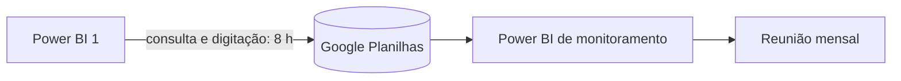

# Monitoramento de Metas pelo BI · contexto e arquitetura

> Aluna: Karine Assunção (CQUAL, NIINS)
> Fonte: `PROJETO.md` completado (29/10/2026) e a arquitetura do curso: **HTML monolítico, offline first**.

---

## 1. O problema

Todo mês, o núcleo consulta o **Power BI 1** (laudos pendentes), digita os
números no **Google Planilhas** e essa planilha alimenta o **Power BI de
monitoramento**, usado na reunião mensal. A digitação e a conferência levam
**8 h por mês** e abrem espaço para erro de digitação.



A aluna quer ler o PDF exportado do Power BI 1 por OCR, porque o PDF é
predominantemente imagem.

## 2. Decisão de arquitetura

Um único `index.html` faz a ponte entre o Power BI 1 e a planilha:

```mermaid
flowchart LR
  PB1[Power BI 1] -->|Exportar dados CSV/Excel<br/>ou PDF| APP
  subgraph index.html no núcleo, offline
    APP[Leitura<br/>SheetJS · pdf.js · Tesseract.js] --> CONF[Conferência<br/>RN01 a RN05]
    CONF --> EXP[Arquivo no layout da planilha]
    APP <--> DB[(IndexedDB<br/>histórico dos meses)]
  end
  EXP -->|importar ou colar| GS[(Google Planilhas)] --> PB2[Power BI de monitoramento]
```

Há três caminhos de leitura, em ordem de preferência:

| Caminho | Quando | Confiabilidade |
|---|---|---|
| 1. **Exportar dados** do visual (CSV/Excel) | se o administrador do Power BI 1 permitir | total, sem OCR |
| 2. PDF com texto | se o PDF tiver camada de texto | alta (pdf.js) |
| 3. PDF em imagem | o caso descrito pela aluna | depende do OCR; conferência obrigatória |

O caminho 1 elimina o maior risco da defesa (erro do OCR). Por isso, o Sprint 0
pergunta à TI se a exportação está liberada, antes de investir no OCR.

**Sem credencial no app**: o app não acessa o Google Drive nem o Power BI. Ele
gera o arquivo, e a pessoa importa na planilha. Isso evita pedir autorização de
API (lacuna citada pela aluna).

## 3. Telas

| Rota | O que faz |
|---|---|
| `#/importar` | Escolher o arquivo do mês; o app detecta o tipo (CSV, Excel, PDF com texto, PDF imagem) |
| `#/conferencia/:mes` | Número lido, mês anterior, variação, alertas; confirmar ou corrigir com motivo |
| `#/exportar/:mes` | Arquivo no layout da planilha (.xlsx ou .csv) e botão copiar |
| `#/historico` | Meses importados, totais, quem aprovou |
| `#/config` | Unidades conhecidas, layout da planilha de destino, backup |

## 4. Modelo de dados (IndexedDB `metas_bi_v1`)

| Store | Campos |
|---|---|
| `relatorios` | id (AAAA-MM), arquivo, tipo, importado_em, aprovado_por, aprovado_em, versao |
| `pendencias` | id, mes_ref, unidade, pendentes, origem (csv, pdf, ocr, digitado), confianca |
| `correcoes` | id, pendencia_id, valor_lido, valor_final, motivo, data |
| `unidades` | nome, apelidos (para casar o texto do relatório) |
| `log` | data_hora, acao, detalhe |

## 5. Conferência (RN01 a RN05)

| Regra | Efeito |
|---|---|
| RN01 mês de referência válido | sem mês, o arquivo é recusado |
| RN02 soma das unidades = total do relatório | bloqueia a aprovação |
| RN03 unidade desconhecida | alerta; a pessoa associa a uma unidade |
| RN04 variação acima de 30% sobre o mês anterior | alerta; a pessoa confirma |
| RN05 mês aprovado não muda | correção cria nova versão com motivo |

## 6. Bibliotecas embutidas

SheetJS (ler CSV/Excel e gerar o arquivo), pdf.js (texto do PDF) e, no Sprint 5,
Tesseract.js com o idioma português (OCR). Com o OCR, o arquivo passa de 10 MB;
se pesar demais, o OCR vai para um segundo arquivo `ocr.html`.

## 7. KPIs

Tempo mensal de atualização (linha de base: 8 h; meta: menos de 1 h) e números
corrigidos na conferência (meta: zero depois da conferência). Piloto de 3 meses
comparando o app com a digitação manual.
