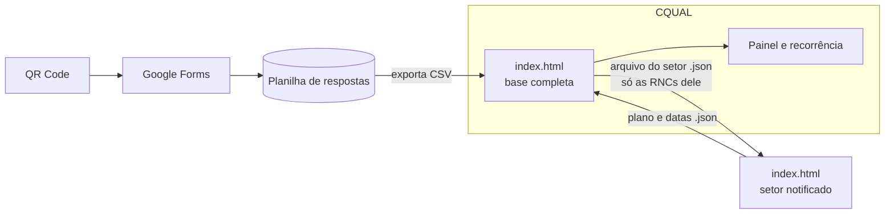

# Registro de Não Conformidade · contexto e arquitetura

> Aluna: Sabrina (CQUAL)
> Fonte: `PROJETO.md` completado (29/10/2026) e a arquitetura do curso: **HTML monolítico, offline first**.

---

## 1. O problema

O registro já é automatizado: o setor relator abre a RNC por QR Code (Google
Forms), a resposta cai numa planilha e no Trello, e o Autocrat gera o FOR 1 em
PDF. Mesmo assim, **toda etapa volta para a CQUAL**: ela valida, notifica,
cobra o plano de ação (FOR 2), cobra a avaliação (FOR 3) e encerra.

| Etapa (AS-IS) | Quem | Tempo informado |
|---|---|---|
| Registro (FOR 1) | Setor relator | imediato |
| Validação | CQUAL | 24 h |
| Notificação | CQUAL | 24 h |
| Plano de ação (FOR 2) | Setor notificado | até 30 dias (720 h) |
| Avaliação (FOR 3) | Setor relator | 48 h |
| Encerramento | CQUAL | 48 h |

**Volume**: 20 RNCs no primeiro mês do piloto. **Exceções**: sem complemento em
5 dias, a RNC é anulada; casos graves vão para a corregedoria.

## 2. O que o MVP faz e o que não faz

| Faz | Não faz |
|---|---|
| Importa a planilha do Forms (CSV) sem mudar o QR Code | Substitui o Sigadoc (meio oficial) |
| Mostra a cada setor as RNCs em que ele é relator ou notificado | Envia notificação oficial |
| Prazos de cada etapa (5 e 30 dias) e alertas | Identifica o servidor envolvido |
| Painel: setores e categorias com mais RNCs, recorrência, vencidos | Encaminha à corregedoria |

## 3. Arquitetura

O Forms continua sendo a porta de entrada, porque o QR Code garante a adesão
(a aluna pediu que isso não mude). O app é um único `index.html` que lê a
planilha exportada, acompanha as etapas e mostra o painel.

- **Cópia da CQUAL**: base completa, importação, validação e painel.
- **Cópia do setor**: recebe só as RNCs dele (RN06), registra o envio do plano e
  a avaliação, e devolve o arquivo. O Sigadoc continua como registro oficial.

## 4. Telas

| Rota | Quem | O que faz |
|---|---|---|
| `#/painel` | todos | RNCs por etapa, vencidas, setores e categorias, recorrência |
| `#/minhas` | setor | RNCs em que o setor é relator ou notificado, com prazo |
| `#/rnc/:id` | CQUAL e setor | Etapas, prazos, FOR 1, 2 e 3 |
| `#/importar` | CQUAL | CSV do Forms, associação de colunas, duplicados |
| `#/exportar` | CQUAL | Arquivo de cada setor |
| `#/config` | todos | Perfil (CQUAL ou setor), categorias, backup |

## 5. Modelo de dados (IndexedDB `rnc_v1`)

| Store | Campos |
|---|---|
| `rncs` | numero (DIRETORIA/ANO-SEQ), aberta_em, setor_relator, setor_notificado, categoria, gravidade, descricao, etapa, situacao |
| `etapas` | id, rnc, etapa, inicio, fim, prazo |
| `planos` | id, rnc, causa, acoes, enviado_em, prorrogado_ate |
| `avaliacoes` | id, rnc, eficaz, observacao, avaliado_em |
| `setores` | sigla, nome, diretoria |
| `log` | data_hora, acao, rnc, detalhe |

## 6. Regras de cálculo

| Regra | Cálculo |
|---|---|
| RN02 | complemento pedido + 5 dias sem resposta → anulada |
| RN03 | prazo do plano = validação + 30 dias (ou a prorrogação aprovada) |
| RN05 | recorrência = mesmo setor notificado + mesma categoria em 90 dias |
| Tempo por etapa | fim − início de cada etapa; média por setor |

## 7. LGPD

Só setores, sem nome de servidor (RN07). A descrição pode conter informação
sensível, por isso a cópia do setor recebe só as RNCs dele, e o GitHub Pages
publica o app sem dados.

## 8. KPIs

Tempo até o plano de ação, RNCs que voltam para a CQUAL (cobranças),
recorrência por setor e categoria, RNCs vencidas.
