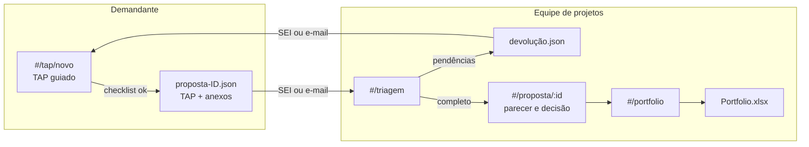

# TAP Digital e Portfólio de Projetos · contexto e arquitetura

> Aluna: Danielle Marques de Almeida Trevizan
> Fonte: `PROJETO.md` completado (29/10/2026) e a arquitetura do curso: **HTML monolítico, offline first**.

---

## 1. O problema

A proposta de projeto chega à equipe em formatos variados, com o TAP incompleto
e documentos faltando. Por isso, a equipe pede ajustes antes mesmo de começar a
análise, e o Portfólio de Projetos Estratégicos fica desatualizado.

O fluxo atual tem **10 etapas**, do recebimento à captação de recursos. A
hipótese da aluna: **a maior parte do retrabalho acontece antes da análise
técnica**. Volume e tempo ainda não são medidos; a linha de base sai de 4
semanas de registro.

## 2. O que o MVP faz e o que não faz

| Faz | Não faz |
|---|---|
| TAP guiado, com instruções, campos obrigatórios e checklist de anexos | Aprova ou rejeita projeto |
| Aponta pendências antes do envio | Substitui o parecer técnico |
| Gera o pacote da proposta (TAP + anexos) para o canal oficial | Calcula prioridade sem critério aprovado |
| Triagem pela equipe, com pendências, motivos e datas | Submete a financiadores |
| Portfólio com status, prioridade justificada e exportação Excel | Integra com sistemas não autorizados |
| Indicadores do piloto | |

**Critério de aceite** (da aluna): validação correta dos campos e do checklist,
com registro claro das pendências.

## 3. Arquitetura

O mesmo `index.html` atende três perfis. O demandante e a equipe não precisam
de servidor: a proposta viaja como **pacote `.json`** (com os anexos dentro)
pelo canal oficial (SEI ou e-mail), como a aluna pediu ao evitar hospedagem
pública antes da TI.

- **Pacote**: o JSON leva os dados do TAP e os anexos em base64, com um código
  de verificação. A equipe importa e vê na hora o que falta.
- **Decisão**: o app registra a decisão da instância competente (autor, data,
  justificativa). Não decide nada sozinho (RN07).

## 4. Telas

| Rota | Perfil | O que faz |
|---|---|---|
| `#/tap/novo` | Demandante | TAP guiado em etapas, checklist de anexos, pendências antes do envio, gerar pacote |
| `#/minhas` | Demandante | Propostas, status, pendências devolvidas |
| `#/triagem` | Equipe | Importar pacotes, conferir checklist, registrar pendência ou aceitar |
| `#/proposta/:id` | Equipe e autoridade | TAP, anexos, pendências, parecer, decisão, histórico |
| `#/portfolio` | Equipe | Projetos aprovados, prioridade com justificativa, captação, exportar Excel |
| `#/indicadores` | Equipe | TAPs completos no 1º envio, devoluções, tempo de triagem |
| `#/config` | todos | Perfil, campos e documentos obrigatórios, backup |

## 5. Modelo de dados (IndexedDB `tap_portfolio_v1`)

| Store | Campos |
|---|---|
| `propostas` | id, titulo, unidade, responsavel, contato, objetivo, justificativa, objetivo_estrategico, valor_estimado, prazo_meses, status, enviado_em, recebido_em, completa_em |
| `anexos` | id, proposta_id, tipo, nome, conteudo |
| `pendencias` | id, proposta_id, motivo, aberta_em, resolvida_em |
| `decisoes` | id, proposta_id, tipo, texto, autor, data |
| `portfolio` | proposta_id, prioridade, justificativa_prioridade, fonte_recurso, situacao_captacao |
| `documentos` | tipo, nome, obrigatorio (checklist, editável pela equipe) |
| `log` | data_hora, acao, proposta_id, detalhe |

## 6. Regras

RN01 a RN08 no `PROJETO.md`. O checklist (store `documentos`) e os campos
obrigatórios são **configuráveis**, porque o modelo oficial do TAP ainda não
veio; a equipe ajusta sem mexer no código.

## 7. LGPD

Nome institucional, unidade e contato do responsável. Sem CPF. Os anexos
ficam no computador da equipe. Base legal e retenção a validar com o jurídico
e o encarregado de dados (registrado pela aluna).

## 8. KPIs

TAPs completos no primeiro envio, devoluções por proposta e tempo até a
documentação completa. Piloto de 60 a 90 dias com unidades selecionadas.
